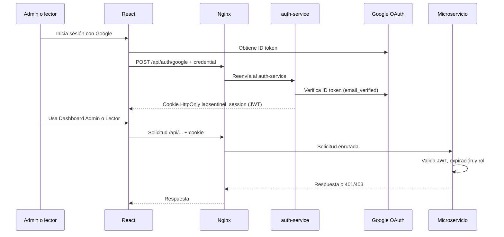
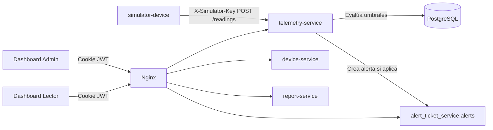

# Arquitectura lógica y de seguridad

## Componentes

| Componente | Responsabilidad | Acceso |
| --- | --- | --- |
| React | Dashboards Admin y Lector, tickets, telemetría | Admin y lector |
| Nginx | Entrada única y proxy inverso | Público (`:8080`) |
| auth-service | Google OAuth, cookie JWT HttpOnly, roles `0`/`1` | Login y sesión |
| Keycloak | Identidad legacy / opcional en desarrollo | Puerto `8081` |
| Device service | Inventario y umbrales | Admin escribe; lector consulta |
| Telemetry service | Lecturas del simulador e historial | Simulador publica; usuarios consultan |
| Alert-ticket service | Alertas y tickets no críticos | Admin gestiona alertas; lector crea tickets |
| Report service | Resúmenes de dashboards | Admin completo; lector limitado |
| Simulator device | Genera lecturas periódicas | Clave `X-Simulator-Key` |
| PostgreSQL | Persistencia por esquemas | Solo red interna de servicios |

## Flujo principal (sesión actual)

## Flujo de telemetría y alertas

## Controles de seguridad

- Credenciales de sesión en cookie HttpOnly; no se almacenan tokens de Google en el frontend.
- Cada servicio verifica firma, expiración y rol del JWT; no confiar solo en la UI o el gateway.
- `ADMIN_EMAILS` solo aplica al primer alta; el rol en BD no se sobrescribe en logins posteriores.
- Secretos solo en `.env` (no versionado).
- Errores 401/403 sin filtrar secretos.

## Decisiones adoptadas

FastAPI/Python 3.11, React/Vite, Google OAuth + JWT propio, RBAC (`0` admin / `1` lector), Nginx, PostgreSQL 18 y Docker Compose. Desarrollo local en HTTP; HTTPS/TLS queda como mejora de despliegue.
